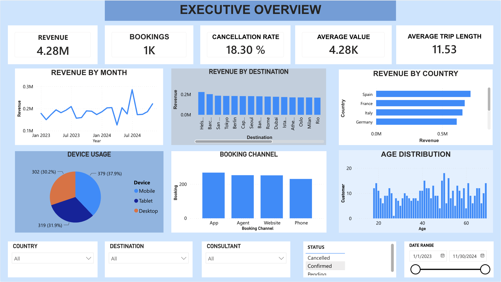
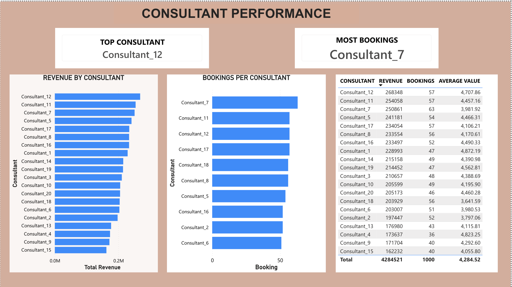
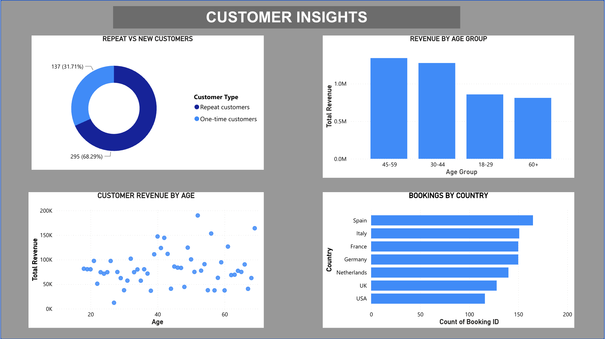
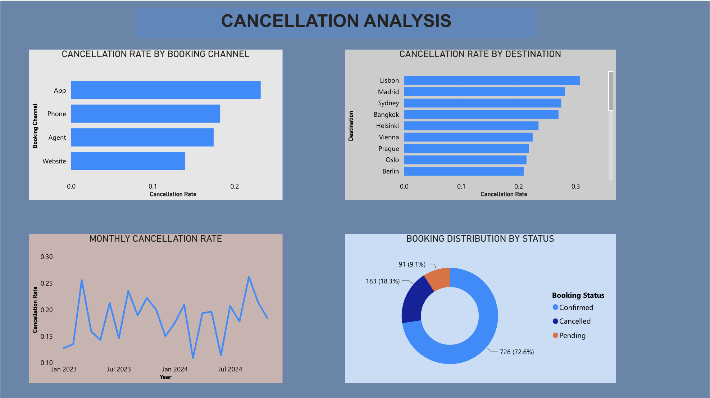

# Customer Travel Booking Analytics Dashboard



## Project Overview

I built this project to practice working with real-world style data from end to end. It covers 1,000 customer travel bookings and looks at things like revenue trends, customer behavior, consultant performance, and cancellations. The idea was to go through the full analyst workflow: raw data, cleaning, querying, and finally a dashboard that someone in a business could actually use.

## The Problem I Was Solving

Travel companies have a lot of booking data but it is easy to lose track of what is actually driving revenue, which consultants are performing well, or why customers are cancelling. This project tries to answer those questions in one place.

## Tools I Used

- **Excel** for structuring the raw data into tables
- **Python (Pandas)** for cleaning the data, run in Google Colab
- **SQL (SQLite via DB Browser)** for writing business queries against the cleaned data
- **Power BI Service** for building the interactive dashboard
- **GitHub** for hosting the project

## Dataset

| Table | Rows | What it contains |
|---|---|---|
| Bookings | 1,000 | Revenue, dates, status, channel, consultant, destination, country, device, trip length |
| Customers | 500 | Age, gender, country, language |
| Consultants | 20 | Team, manager, experience level |
| Destinations | 25 | Region, average trip cost |

The bookings run from January 2023 to November 2024.

## What I Did

### Data Cleaning (Python)
I loaded each sheet as its own DataFrame, checked for missing values and duplicates, standardized the date columns, and exported clean CSVs ready for SQL and Power BI.

### SQL Analysis
I imported the cleaned data into a SQLite database and wrote 8 queries covering total revenue, revenue by country, cancellation rate, top destinations by bookings, consultant performance, average booking value, monthly trends, and booking channel breakdown.

### Power BI Dashboard
I imported all four tables, built relationships between them (Bookings connects to Customers, Consultants, and Destinations through their shared ID columns), and created custom DAX measures for cancellation rate, confirmation rate, repeat and one-time customer counts, the top consultant by revenue, and the consultant with the most bookings. The dashboard has four pages:

- **Executive Overview** has five KPI cards (Revenue, Bookings, Cancellation Rate, Average Value and Average Trip Length), charts for Revenue by Month, Revenue by Destination, Revenue by Country, Device Usage, Booking Channel and Age Distribution, and slicers for Country, Destination, Consultant, Status and Date Range
- **Consultant Performance** shows the Top Consultant and Most Bookings cards, the Revenue by Consultant and Bookings per Consultant charts, and a table of revenue, bookings and average value for each consultant
- **Customer Insights** covers Repeat vs New Customers, Revenue by Age Group, Customer Revenue by Age and Bookings by Country
- **Cancellation Analysis** shows the Cancellation Rate by Booking Channel, Cancellation Rate by Destination, Monthly Cancellation Rate and Booking Distribution by Status

## Key Insights

- Spain generated the highest booking volume and revenue by country, with France and Italy next in revenue, suggesting these markets should be prioritised for future campaigns.
- Consultant_12 was the top revenue generator at 268,348, while Consultant_7 handled the most bookings at 63, showing that booking volume and revenue performance do not always align across the team.
- Customers aged 45 to 59 generated the highest total revenue by age group (about 1.34M), followed closely by 30 to 44. Part of this is size, as 45 to 59 is the largest age group in the Customers table.
- 295 of the 432 customers with at least one booking (68.3%) booked more than once, so keeping existing customers matters as much as winning new ones.
- The App channel had both the highest usage and the highest cancellation rate at 23.2%, well above the 18.3% overall rate and the Website channel's 13.9%, which is worth investigating since acquiring app users who then cancel has a direct cost impact.
- Lisbon had the highest cancellation rate of any destination at about 31%, which could point to pricing, availability, or expectation issues specific to that market. Each destination has only 32 to 51 bookings, so I treat this as a signal to look into and not a firm conclusion.
- 72.6% of all bookings were confirmed, with cancellations sitting at 18.3% and pending at 9.1%, giving a solid baseline for tracking improvement over time.
- Monthly cancellation rate moved between about 11% (March 2024) and 26% (September 2024) without a clear trend, and with only 31 to 58 bookings a month, single months swing a lot.

## Notes on the Data

**Revenue includes every booking status.** The 4.28M Revenue figure counts cancelled and pending bookings as well as confirmed ones. Setting the Status slicer to Confirmed shows revenue from confirmed bookings only, which is about 3.10M.

**The dataset is simulated.** A few fields do not line up the way real data would. About a third of the bookings (373 of 1,000) have a travel date earlier than the booking date, the country on a booking often differs from the customer's own country, and the regions in the Destinations table do not match real geography (Sydney is listed under Europe, for example). The dashboard does not use the Region field or the travel dates, and Country refers to the country recorded on each booking.

## Skills This Project Covers

- Data cleaning with Python and Pandas
- SQL querying for business analysis
- DAX measure writing in Power BI
- Data modelling with relationships between tables
- Dashboard design and layout
- KPI reporting
- Translating data into business insights

## Repo Structure

```
Customer-Travel-Analytics-Dashboard/
│
├── data/           cleaned CSV files
├── sql/            queries.sql
├── python/         data cleaning notebook
├── images/         dashboard screenshots
└── README.md
```

## Dashboard Preview

### Executive Overview


**Business Purpose & Stakeholder Value**

The Executive Overview provides a high-level view of the company's travel booking performance through key metrics such as total revenue, total bookings, average booking value, average trip length and cancellation rate.

I chose these metrics because they give stakeholders an immediate understanding of overall business performance without requiring them to go through individual booking records. The monthly revenue trend helps identify changes in business performance over time, while revenue by destination and country highlights the markets contributing most to revenue. Booking channel analysis and interactive filters allow stakeholders to explore performance from different perspectives.

**Stakeholder Value:** This page helps management monitor overall performance, identify high-performing markets, understand booking trends and recognise areas that may require further investigation. It provides a starting point for strategic decisions around market focus, business performance and revenue opportunities.

### Consultant Performance


**Business Purpose & Stakeholder Value**

This page focuses on consultant productivity and revenue contribution. I included total revenue by consultant, booking volumes, average booking value and a consultant performance table to provide a balanced view of individual contributions.

I chose to analyse both revenue and booking volume because a high number of bookings does not necessarily translate into the highest revenue. Comparing these measures helps distinguish consultants who generate more bookings from those who contribute more revenue. The rankings and detailed table allow stakeholders to compare performance across the consultant team.

**Stakeholder Value:** This dashboard helps management identify top-performing consultants, understand differences in individual performance and recognise potential areas for improvement. These insights can support performance reviews, targeted coaching, resource allocation and the development of appropriate performance strategies.

### Customer Insights


**Business Purpose & Stakeholder Value**

This page explores customer characteristics, booking behaviour and revenue contribution. I included customer segmentation, one-time versus repeat customers, revenue by age group and bookings by country to understand how different customer groups interact with the business.

I chose these metrics because understanding who the customers are is just as important as understanding how much revenue they generate. The comparison between one-time and repeat customers helps highlight customer retention patterns, while age-group and country analysis provides additional context around customer segments and their contribution to revenue.

**Stakeholder Value:** This page helps stakeholders understand customer behaviour, identify valuable customer segments and recognise patterns in repeat bookings. These insights can inform customer retention initiatives, targeted marketing campaigns and decisions about which customer segments may offer further business opportunities.

### Cancellation Analysis


**Business Purpose & Stakeholder Value**

This page examines booking cancellations to understand how cancellation behaviour varies across booking channels, destinations and months. I included the overall cancellation rate, cancellation rate by channel, cancellation rate by destination, monthly cancellation trends and booking distribution by status.

I chose these measures because cancellations can affect revenue performance and booking reliability. Analysing cancellation rates across different categories helps identify where cancellations are more frequent, rather than looking only at the overall cancellation figure. The monthly trend also helps stakeholders observe changes in cancellation patterns over time.

**Stakeholder Value:** This page helps management identify booking channels and destinations with relatively high cancellation rates, monitor changes over time and investigate possible causes. The findings can support further investigation into booking processes, customer behaviour and strategies to improve booking retention.

## Author

Edidiong Akama
